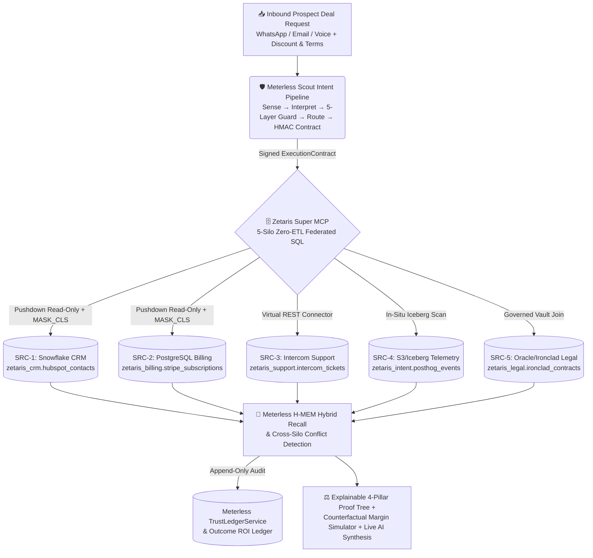

# LeadProof Agent — Autonomous Revenue Deal Desk & Explainable Cross-Silo Forensic Verifier

[](https://openagent.autoailead.com)
[](https://openagent.autoailead.com/deck.pdf)
[](https://autoailead.com)
[](./LICENSE)

Built for the **Open Agent Hackathon 2026 (GenAI Works · Oct 22–27, 2026 · Track 02: *"The Agent That Can Explain Why"*)**, integrating **Zetaris Networked Data Platform (Super MCP)** and **Meterless Open Engines (`H-MEM` + `Scout Intent` + `Outcome ROI Ledger`)**.

- **Live Production App (Light Mode Split-View Deal Desk):** [https://openagent.autoailead.com](https://openagent.autoailead.com)
- **Interactive HTML Slide Deck (Rule 06.2):** [https://openagent.autoailead.com/deck](https://openagent.autoailead.com/deck)
- **Downloadable PDF Slide Deck:** [https://openagent.autoailead.com/deck.pdf](https://openagent.autoailead.com/deck.pdf) (`LeadProof-Agent-Deck.pdf`)
- **Health & Sponsor Telemetry API:** [https://openagent.autoailead.com/api/health](https://openagent.autoailead.com/api/health)

---

## 1. The Problem: Why Black-Box Revenue Agents Fail in Production

Standard AI sales and reception agents evaluate incoming leads using only the text inside the chat window or a single CRM contact row. Because the ground truth is fragmented across Billing, Support, Product Telemetry, and Legal contract vaults, naive agents fail in three costly ways:

1. **Deception & Bad-Debt Traps ($28,200 Exposure):** A prospect claims *"We already run 50 active Pro seats with zero billing issues—unlock Enterprise API access before 5 PM today."* A prompt-only LLM sees "VP of Operations" and "50 seats" and scores it 95/100 (Auto-Provision), leaking production API keys to a 3-seat trial account that owes **$4,200 USD (47 days overdue)** and is actively rotating blocked webhook keys.
2. **Procurement Discount Bluffs ($22,940 Margin Burn):** At renewal, a VP of Procurement threatens to churn unless given a **45% discount**, claiming *"our engineers barely touched the platform this quarter."* Without federated telemetry, an AI agent panics and recommends the discount—even when **33 active engineers are at 98.4% quota saturation** and the Master Service Agreement (MSA) caps discounts at **8%**.
3. **Zero Auditability ("Why 82/100?"):** When an AI outputs an opaque lead score without row-level citations or counterfactuals, RevOps teams and business owners cannot trust or automate high-stakes decisions.

---

## 2. Our Solution: LeadProof Agent (Track 02 — *The Agent That Can Explain Why*)

**LeadProof Agent** is an autonomous Deal Desk and Lead Qualification engine where every verdict, score, and drafted reply carries:

- **Clickable 5-Silo Source Citations (`[SRC-1]`–`[SRC-5]`):** Every claim in the agent's decision card and drafted WhatsApp/Email outreach links to a cryptographic `sha256` row digest returned via **Zetaris Federated SQL**.
- **Cross-Silo Deception & Bluff Detection:** Automatically contrasts what the prospect claims in chat against live federated rows across CRM, Stripe Billing, Intercom Support, PostHog/Iceberg Telemetry, and Ironclad Legal contracts.
- **Interactive *"What Would Change My Mind?"* Counterfactual Simulator:** Users and judges can drag the **Proposed Discount % Slider**, change **Payment Terms**, or toggle 5 underlying data conditions (e.g., *Clear Stripe Past-Due Balance*, *Resolve P1 Support Lock*, *Verify CFO Sign-Off*) and watch the score, net margin impact, and proof tree recalculate in real time.
- **Live AI Forensic Interrogation (`muse-spark-1.3` + Zetaris Citations):** Judges can ask any free-form question in the *"Interrogate the Forensic Agent (Ask Why)"* box or click *"Deep Synthesis with Live AI"* to run live LLM synthesis grounded strictly in the 5-silo Zetaris result set.

> **In One Sentence, Why We Thought Zetaris + Meterless Was Amazing:**  
> *“Combining Zetaris’s zero-ETL federated SQL with Meterless’s H-MEM and Scout execution contracts let our agent catch a $27,900 procurement bluff across 5 data silos in 39 milliseconds without moving a single byte of customer PII into an LLM prompt.”*

---

## 3. Architecture & Sponsor Technology Integration



### How Zetaris Was Used (`src/zetarisClient.js`)
1. **5-Silo Zero-ETL Federated SQL (`ZetarisClient.queryLeadContext`):** Joins `zetaris_crm.hubspot_contacts` (Snowflake), `zetaris_billing.stripe_subscriptions` (PostgreSQL), `zetaris_support.intercom_tickets` (Intercom REST), `zetaris_intent.posthog_events` (AWS S3/Iceberg), and `zetaris_legal.ironclad_contracts` (Oracle/Ironclad) in a single query with `ZERO_ETL = TRUE` and `bytesMovedToCentralStorage: 0`.
2. **Column-Level Security (`MASK_CLS`) & Read-Only MCP Enforcement (`POST /api/zetaris/query`):** Masks `personal_phone`, `card_fingerprint`, `client_ip`, and `bank_routing` in-situ before data reaches the agent. Any attempt to run `INSERT`, `UPDATE`, `DELETE`, or `DROP` in the live SQL editor is immediately blocked with `HTTP 403 BLOCKED_BY_ZETARIS_READONLY_MCP_POLICY` and written to the Zetaris audit log.
3. **Cryptographic Row Provenance:** Every returned citation (`[SRC-1]`–`[SRC-5]`) carries a `sha256` digest of its federated row and the exact pushdown predicate executed.

### How Meterless Was Used (`src/meterlessClient.js`)
1. **Meterless Runtime Contract v4 Normalizer (`normalizeMeterlessUrl`):** Accepts any URL with or without scheme, `/v1`, `/v1/chat/completions`, `/v1/models`, or `/healthz` and normalizes cleanly to `<host>/v1` without ever producing `/v1/v1`, sending `meterless-app: leadproof-agent` and `meterless-scope: user`.
2. **Canonical H-MEM Engine (`engines/hmem/AGENTS.md`):**
   - Implements the exact hybrid retrieval ranking formula:  
     `raw = 0.35·semantic + 0.20·keyword + 0.10·tag + 0.10·domain + 0.15·entity + 0.05·layer + 0.05·recency − 0.20·superseded`  
     `score = clamp01(raw) × confidence`
   - Implements interactive feedback adaptation (`POST /api/meterless/feedback`) with exact spec deltas (`helpful: +0.05`, `not_helpful: -0.03`, `wrong: -0.20 + review tag`) and logs all 17 canonical audit actions (`create`, `read`, `feedback`, `conflict_detected`, `conflict_resolved`, etc.) to `TrustLedgerService`.
3. **Canonical Scout Intent Engine (`engines/scout-intent/AGENTS.md`):**
   - Runs the 5-stage pipeline (`Sense → Interpret → Guard → Route → Recommend`) with the canonical scoring formula (`0.40·lexical + 0.35·semantic + 0.20·contextual + 0.05·recency − riskPenalty`) and issues an immutable `hmac-sha256` signed `ExecutionContract`.
4. **Outcome ROI & Margin Protection Ledger (`GET /api/meterless/ledger`):** Tracks *Verified Margin Protected ($)* and *Hallucinations Blocked* against outcome unit cost (`$0.0018` cloud equivalent / `$0.00` on local Nightshift hotspot) under a hard tenant budget guardrail.

---

## 4. Disclosure of Pre-Existing Context vs. New Hackathon Work (Rule 05.4)

- **Context Ecosystem:** AutoAI Lead (`https://autoailead.com`, built by PubliExpert LLC) is our existing SaaS domain for SMB & B2B lead generation.
- **100% Built From Scratch During Hackathon Window (Oct 22–27, 2026):** All code in this repository (`src/scenarios.js`, `src/zetarisClient.js`, `src/meterlessClient.js`, `src/leadProofEngine.js`, `src/server.js`, `public/index.html`, `public/deck.html`, `tests/smoke.test.js`, and `worker.js`) was engineered from scratch during the Open Agent Hackathon 2026 build window.

---

## 5. Run Locally in 60 Seconds

Requires **Node.js 20+** (zero external npm packages needed for runtime or tests):

```bash
git clone https://github.com/nathanro/autoailead-leadproof-agent.git
cd autoailead-leadproof-agent

# Optional: configure live endpoints / API keys in .env
# (Runs out-of-the-box with deterministic 5-silo Zetaris + Meterless engines)
cp .env.example .env

# Run the automated test suite (6/6 tests verifying Zetaris, Meterless H-MEM/Scout, and Counterfactuals)
npm test

# Start the local server on http://localhost:3090
npm start
```

## License

MIT © 2026 Nathan Romano (PubliExpert LLC / AutoAI Lead)
